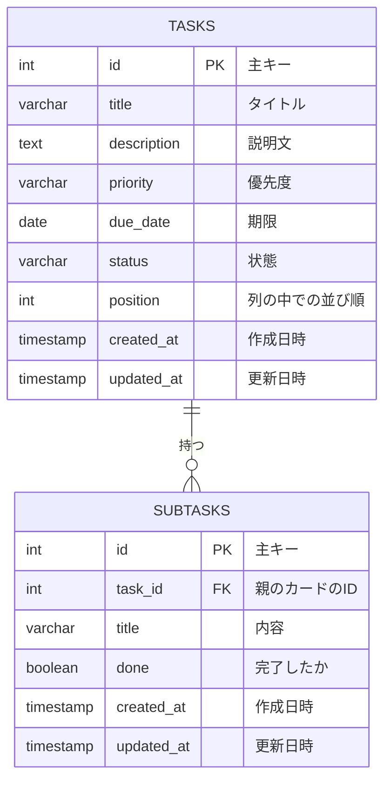

# データベース設計：Trello風タスク管理アプリ

DB で管理するエンティティは「カード（タスク）」と「サブタスク」の2つ。

- 列は「未着手」「進行中」「完了」の3つで固定する。どの列に入っているかは、カードの `status` で表す
- 1つのカードは、複数のサブタスクを持つ（サブタスクがないカードもある）

## ER図

記号の意味：

- `||--o{`：左側の1件に対して、右側が0件以上つながる（1対多）
- `PK`（主キー）：そのデータを見分けるための項目
- `FK`（外部キー）：ほかのテーブルのデータを指す項目

## テーブル定義

型は MySQL の書き方で仮に書いている。DB が決まったら、その DB の型に合わせて直す。

### tasks（カード）

| カラム名 | 型 | 必須 | デフォルト | 説明 |
|---|---|---|---|---|
| id | INT (AUTO_INCREMENT) | YES | - | 主キー |
| title | VARCHAR(255) | YES | - | タイトル |
| description | TEXT | NO | NULL | 説明文 |
| priority | VARCHAR(10) | NO | NULL | 優先度（high / medium / low） |
| due_date | DATE | NO | NULL | 期限 |
| status | VARCHAR(20) | YES | 'todo' | 状態（todo / in_progress / done） |
| position | INT | YES | 0 | 列の中での並び順 |
| created_at | TIMESTAMP | YES | CURRENT_TIMESTAMP | 作成日時 |
| updated_at | TIMESTAMP | YES | CURRENT_TIMESTAMP | 更新日時 |

`status` の値と列の対応：

| status | 列 |
|---|---|
| todo | 未着手 |
| in_progress | 進行中 |
| done | 完了 |

### subtasks（サブタスク）

| カラム名 | 型 | 必須 | デフォルト | 説明 |
|---|---|---|---|---|
| id | INT (AUTO_INCREMENT) | YES | - | 主キー |
| task_id | INT | YES | - | 外部キー（tasks.id） |
| title | VARCHAR(255) | YES | - | 内容 |
| done | BOOLEAN | YES | FALSE | 完了したか |
| created_at | TIMESTAMP | YES | CURRENT_TIMESTAMP | 作成日時 |
| updated_at | TIMESTAMP | YES | CURRENT_TIMESTAMP | 更新日時 |

カードを削除したときは、そのカードのサブタスクもあわせて削除する。
