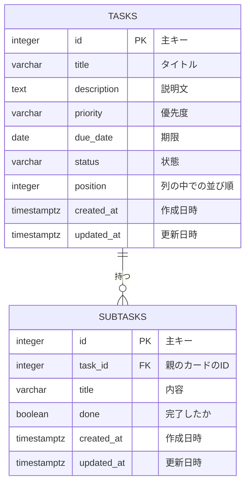

# データベース設計：Trello風タスク管理アプリ

DB で管理するエンティティは「カード（タスク）」と「サブタスク」の2つ。

- 列は「未着手」「進行中」「完了」の3つで固定する。どの列に入っているかは、カードの `status` で表す
- 1つのカードは、複数のサブタスクを持つ（サブタスクがないカードもある）

## ER図

記号の意味：

- `||--o{`：左側の1件に対して、右側が0件以上つながる（1対多）
- `PK`（主キー）：そのデータを見分けるための項目
- `FK`（外部キー）：ほかのテーブルのデータを指す項目

## テーブル定義

型は PostgreSQL の書き方で書いている。

テーブルは、バックエンドを起動したときに Flyway が `backend/src/main/resources/db/migration` の SQL を順に実行して作る（マイグレーション）。テーブルを変えるときは、既存のファイルは書き換えず、新しいファイル（`V2__内容.sql` など）を足す。Hibernate はテーブルを作らず、Entity クラス（`Task.java`・`Subtask.java`）とテーブルが合っているかを確かめるだけにしている（`spring.jpa.hibernate.ddl-auto=validate`）。

`created_at` / `updated_at` は、アプリから保存・更新するときは Hibernate（`@CreationTimestamp` / `@UpdateTimestamp`）が現在時刻を入れる。PostgreSQL は行を更新しても `updated_at` を自動では変えないので、psql などで直接更新するときは SQL で現在時刻を入れる。

日時は、タイムゾーン付きの `TIMESTAMPTZ` で保存する。アプリ（日本時間）から入れても DB の DEFAULT（UTC）で入れても、同じ時点として扱われる。

### tasks（カード）

| カラム名 | 型 | 必須 | デフォルト | 説明 |
|---|---|---|---|---|
| id | INTEGER GENERATED BY DEFAULT AS IDENTITY | YES | - | 主キー（自動で番号を振る） |
| title | VARCHAR(255) | YES | - | タイトル（アプリでは100文字までに制限する） |
| description | TEXT | NO | NULL | 説明文 |
| priority | VARCHAR(10) | NO | NULL | 優先度（high / medium / low） |
| due_date | DATE | NO | NULL | 期限 |
| status | VARCHAR(20) | YES | 'todo' | 状態（todo / in_progress / done） |
| position | INTEGER | YES | 0 | 列の中での並び順 |
| created_at | TIMESTAMPTZ | YES | CURRENT_TIMESTAMP | 作成日時 |
| updated_at | TIMESTAMPTZ | YES | CURRENT_TIMESTAMP | 更新日時 |

`status` の値と列の対応：

| status | 列 |
|---|---|
| todo | 未着手 |
| in_progress | 進行中 |
| done | 完了 |

`id` は `GENERATED BY DEFAULT`（番号を手で指定することもできる）にしている。アプリからは番号を指定しないので、自動で番号が振られる。

### subtasks（サブタスク）

`V2__create_subtasks.sql` で作る。

| カラム名 | 型 | 必須 | デフォルト | 説明 |
|---|---|---|---|---|
| id | INTEGER GENERATED BY DEFAULT AS IDENTITY | YES | - | 主キー（自動で番号を振る） |
| task_id | INTEGER | YES | - | 外部キー（tasks.id） |
| title | VARCHAR(255) | YES | - | 内容 |
| done | BOOLEAN | YES | FALSE | 完了したか |
| created_at | TIMESTAMPTZ | YES | CURRENT_TIMESTAMP | 作成日時 |
| updated_at | TIMESTAMPTZ | YES | CURRENT_TIMESTAMP | 更新日時 |

カードを削除したときは、そのカードのサブタスクもあわせて削除する（外部キーに `ON DELETE CASCADE` を付ける）。アプリから削除するときは、Hibernate も読み込んだサブタスクを削除する（`Task.java` の `subtasks` に付けた `cascade = CascadeType.REMOVE`）。

サブタスクはカードごとに取り出すので、`task_id` に索引（`subtasks_task_id_idx`）を付けている。
