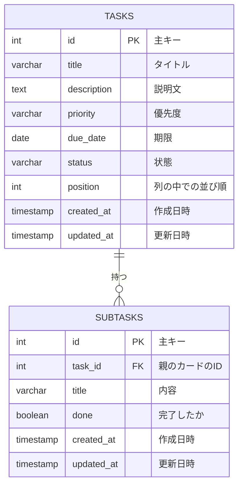

# 要件定義書：Trello風タスク管理アプリ

画面や操作の細かい仕様は [詳細仕様メモ](spec.md)、完成かどうかの確認項目は [受け入れ基準](acceptance.md) にまとめる。

---

## 1. 目的・背景

- タスクを「未着手／進行中／完了」の列に分けて並べ、進み具合をひと目で分かるようにする。
- RaiseTech AIコースのカリキュラムとして、AI（Claude Code）を使いながら要件定義から実装までの流れを経験する。

## 2. 利用者

- 開発者本人（1人）が使う。
- PCのブラウザで使う。

### 2.1 ユースケース

利用者がアプリをどう使うかを、必須の機能の範囲で示す。

#### UC-01 やることを登録する

使う機能：F-11〜F-16

1. ボードを開く
2. 「未着手」列にタイトルを入力して、カードを追加する
3. 必要ならカードを開き、説明文・期限・優先度を設定する

#### UC-02 やることを確認する

使う機能：F-01, F-12, F-17

1. ボードを開く
2. 各列のカードのタイトル・期限・優先度を見て、次に取りかかるものを決める
3. 詳しく知りたいカードを開いて、説明文を読む

#### UC-03 進み具合を更新する

使う機能：F-19

1. 取りかかったカードを「進行中」列へドラッグする
2. 終わったカードを「完了」列へドラッグする

#### UC-04 内容を変更する

使う機能：F-12〜F-16

1. カードを開く
2. タイトル・説明文・期限・優先度を書き換える
3. 詳細画面を閉じる

#### UC-05 不要なカードを削除する

使う機能：F-12, F-18

1. カードを開く
2. ［削除］を押し、確認で「OK」を選ぶ

#### UC-06 続きから使う

使う機能：F-31, F-32

1. ブラウザを閉じる
2. 後日、アプリを起動してブラウザで開く
3. 前回の状態のボードが表示される

## 3. 機能要件

優先度の意味は次のとおり。

- **必須**：今回かならず作る
- **任意**：必須の機能ができてから、余裕があれば作る

### 3.1 ボード・列

| ID | 機能 | 優先度 |
|---|---|---|
| F-01 | 「未着手」「進行中」「完了」の3列を横に並べて表示できる | 必須 |

### 3.2 カード（タスク）

| ID | 機能 | 優先度 |
|---|---|---|
| F-11 | 各列でタイトルを入力してカードを追加できる | 必須 |
| F-12 | カードをクリックすると詳細画面が開き、内容を確認できる | 必須 |
| F-13 | 詳細画面でタイトルを編集できる | 必須 |
| F-14 | 詳細画面で説明文を設定・編集できる（入力は任意） | 必須 |
| F-15 | 詳細画面で期限（日付）を設定・変更・解除できる（入力は任意） | 必須 |
| F-16 | 詳細画面で優先度（高・中・低）を設定・変更・解除できる（入力は任意） | 必須 |
| F-17 | ボード上のカードにタイトル・期限・優先度を表示する | 必須 |
| F-18 | カードを削除できる（削除前に確認を表示する） | 必須 |
| F-19 | ドラッグ&ドロップでカードを別の列へ移動できる | 必須 |
| F-20 | 列の中のカードを優先度の高い順に並べ替えられる | 任意 |

### 3.3 サブタスク（チェックリスト）

| ID | 機能 | 優先度 |
|---|---|---|
| F-21 | 詳細画面でカードにサブタスクを追加できる | 任意 |
| F-22 | サブタスクの完了・未完了を切り替えられる | 任意 |
| F-23 | サブタスクを削除できる | 任意 |
| F-24 | ボード上のカードにサブタスクの進み具合（例：2/5）を表示する | 任意 |

### 3.4 保存

| ID | 機能 | 優先度 |
|---|---|---|
| F-31 | 変更のたびにデータを自動で DB に保存する | 必須 |
| F-32 | ページを再読み込みしたり、ブラウザやアプリを起動し直したりしても、DB に保存したデータを表示する | 必須 |

## 4. 非機能要件

| 項目 | 内容 |
|---|---|
| 動作環境 | PCのブラウザ（Google Chrome の最新版） |
| 画面の大きさ | 横幅 1280px 以上の画面で、3列が横スクロールなしで表示される |
| 起動方法 | 自分のPCで DB とバックエンドを起動してから、ブラウザでアプリを開く |
| データの保存先 | DB（自分のPCの中で動かす） |
| 入力チェック | タイトルが空のカードは作れない |
| 操作性 | 主な操作（追加・移動・削除）が3クリック以内でできる |
| 保存に失敗したとき | 保存できなかったことを画面に表示する。操作はそのまま続けられる |
| データを読み込めないとき | 読み込めなかったことを画面に表示する |
| セキュリティ | 入力した文字は、HTML として解釈せず文字のまま表示する（XSS対策）。入力した文字を、そのまま SQL として実行しない（SQLインジェクション対策） |

### データ保存に関する注意（リスク）

データは自分のPCの中で動かす DB に保存するため、次のことに注意する。今回はバックアップの機能を作らないので、消えたデータは元に戻せない。

- DB とバックエンドを起動していないと、アプリを使えない
- DB のデータを削除したり、PCが故障したりすると、データが消える
- 別のPCからは使えない（同じPCの中なら、別のブラウザで開いても同じデータが表示される）

## 5. 画面

### 5.1 ボード画面（メイン）

```
+--------------------------------------------------+
| タスク管理ボード                                 |
+----------------+----------------+----------------+
| 未着手         | 進行中         | 完了           |
| +------------+ | +------------+ | +------------+ |
| | 資料を作る | | | API調査    | | | 環境構築   | |
| | [高] 11/20 | | | [中] 1/3   | | |            | |
| +------------+ | +------------+ | +------------+ |
| [+ カード追加] | [+ カード追加] | [+ カード追加] |
+----------------+----------------+----------------+
```

- `[高]` `[中]`：優先度
- `11/20`：期限
- `1/3`：サブタスクの進み具合（3つのうち1つが完了）

### 5.2 カード詳細画面（ポップアップ）

```
+----------------------------------+
| タイトル：[資料を作る          ] |
| 説明文：  [                    ] |
|           [                    ] |
| 期限：    [2026/11/20]           |
| 優先度：  [高 v]                 |
| サブタスク：                     |
|   [x] 構成を考える         (x)   |
|   [ ] 下書きを書く         (x)   |
|   [+ サブタスクを追加]           |
|                                  |
| [削除]                 [閉じる]  |
+----------------------------------+
```

- `[x]` `[ ]`：サブタスクの完了・未完了
- `(x)`：サブタスクを削除するボタン
- `[高 v]`：優先度を選ぶプルダウン

## 6. データ

DB で管理するエンティティは「カード（タスク）」と「サブタスク」の2つ。

- 列は「未着手」「進行中」「完了」の3つで固定する。どの列に入っているかは、カードの `status` で表す
- 1つのカードは、複数のサブタスクを持つ（サブタスクがないカードもある）

### 6.1 ER図



記号の意味：

- `||--o{`：左側の1件に対して、右側が0件以上つながる（1対多）
- `PK`（主キー）：そのデータを見分けるための項目
- `FK`（外部キー）：ほかのテーブルのデータを指す項目

### 6.2 テーブル定義

型は MySQL の書き方で仮に書いている。DB が決まったら、その DB の型に合わせて直す。

#### tasks（カード）

| カラム名 | 型 | 必須 | デフォルト | 説明 |
|---|---|---|---|---|
| id | INT (AUTO_INCREMENT) | YES | - | 主キー |
| title | VARCHAR(255) | YES | - | タイトル |
| description | TEXT | NO | NULL | 説明文 |
| priority | VARCHAR(10) | NO | NULL | 優先度（high / medium / low） |
| due_date | DATE | NO | NULL | 期限 |
| status | VARCHAR(20) | YES | 'todo' | 状態（todo / in_progress / done） |
| position | INT | YES | 0 | 列の中での並び順 |
| created_at | TIMESTAMP | YES | CURRENT_TIMESTAMP | 作成日時 |
| updated_at | TIMESTAMP | YES | CURRENT_TIMESTAMP | 更新日時 |

`status` の値と列の対応：

| status | 列 |
|---|---|
| todo | 未着手 |
| in_progress | 進行中 |
| done | 完了 |

#### subtasks（サブタスク）

| カラム名 | 型 | 必須 | デフォルト | 説明 |
|---|---|---|---|---|
| id | INT (AUTO_INCREMENT) | YES | - | 主キー |
| task_id | INT | YES | - | 外部キー（tasks.id） |
| title | VARCHAR(255) | YES | - | 内容 |
| done | BOOLEAN | YES | FALSE | 完了したか |
| created_at | TIMESTAMP | YES | CURRENT_TIMESTAMP | 作成日時 |
| updated_at | TIMESTAMP | YES | CURRENT_TIMESTAMP | 更新日時 |

カードを削除したときは、そのカードのサブタスクもあわせて削除する。

## 7. 受け入れ基準

必須の機能について、[受け入れ基準](acceptance.md) の確認をすべて満たしたら完成とする。

## 8. 対象外（今回は作らない）

- スマホ・タブレットへの対応
- ログイン・ユーザー管理
- 複数人での共有、複数の端末でのデータ同期
- インターネットへの公開（自分のPCの中だけで動かす）
- 列の追加・列の名前の変更（列は「未着手」「進行中」「完了」の3つで固定する）
- カードの中にカードを入れる入れ子（サブタスクで代わりにする）
- ラベル・絞り込み・検索
- 複数のボード

## 9. 技術・制約

| 項目 | 内容 |
|---|---|
| フロントエンド | React |
| バックエンド | Java / Spring Boot |
| DB | 未定（課題動画を確認して決める） |
| バージョン管理 | Git / GitHub（機能ごとにブランチを作り、プルリクエストでマージする） |
| 開発支援 | Claude Code |
| 期限 | カリキュラムの進み具合に合わせる |

## 10. 将来の追加候補

今回は作らない。使ってみて必要になったら追加を検討する。

- 同じ列の中でカードの並び順を入れ替える
- 期限を過ぎたカードの色を変えて目立たせる
- 完了したカードをまとめて削除する
